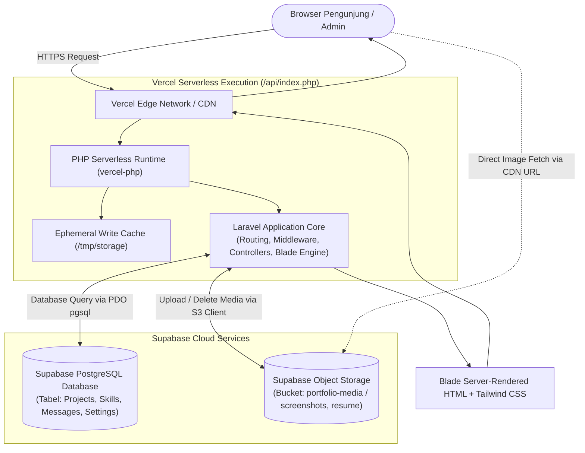
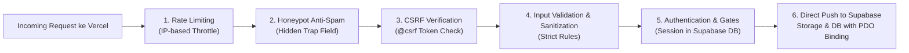
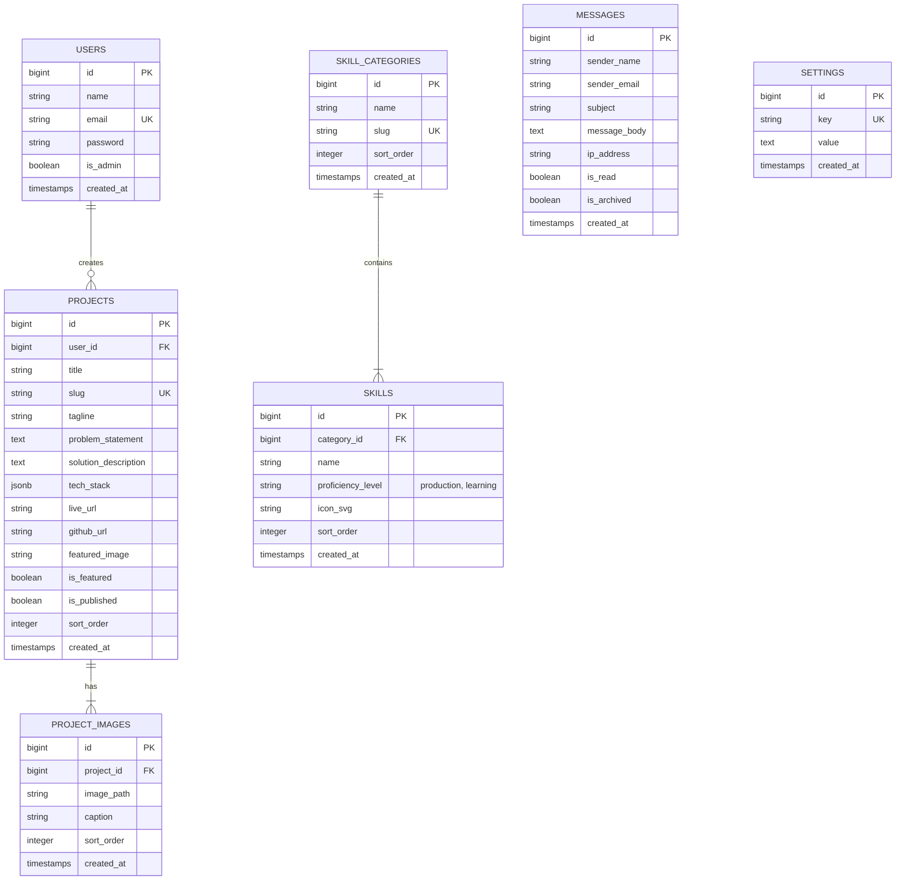

# SYSTEM DESIGN — PERSONAL PORTFOLIO & CMS
**Modern, Clean, Human-Crafted Architecture**
**Deployment Platform: Vercel (Serverless) + Supabase (Database & Storage)**

---

## 1. Executive Summary & Design Philosophy

Dokumen ini mendefinisikan arsitektur sistem, struktur proyek, modul aplikasi, hierarki halaman, *design system*, strategi keamanan, serta arsitektur cloud terintegrasi untuk website portofolio profesional berbasis:
* **Framework:** Laravel 11+ / PHP 8.2+
* **Templating & Frontend:** Blade Views + Tailwind CSS + Alpine.js
* **Hosting Platform:** Vercel (Serverless Edge Runtime)
* **Cloud Database & Storage:** Supabase (PostgreSQL Database + Supabase S3-Compatible Storage)

### Filosofi: *Anti-AI Slop & Human-Designed Aesthetic*
Banyak website modern hasil generasi AI terlihat identik: *mesh gradient* ungu-kebiruan, card mengambang dengan efek *glassmorphism* berlebihan, *border glow*, serta tata letak generik yang tidak memiliki identitas. 

Sistem ini dirancang dengan pendekatan **Editorial Modernism & High-Craft Engineering**:
* **Typographic Rhythm & Hierarchy:** Menekankan keterbacaan, kontras tipe huruf (*modern sans* dipadukan dengan *monospace* untuk aksen teknis), dan *whitespace* yang fungsional.
* **Content-First Storytelling:** Setiap proyek tidak hanya ditampilkan sebagai gambar thumbnail dalam kotak, melainkan sebagai mini *case study* yang memaparkan: *Problem*, *Solution*, *Technical Challenges*, dan *Impact/Demo*.
* **Tactile & Subdued Aesthetics:** Menggunakan garis pembatas tajam (*hairline borders*), palet warna netral yang hangat (*warm neutral/slate*), serta satu warna aksen yang tegas dan tidak murahan.
* **Dual-Environment Agility:** Dirancang mulus untuk berjalan secara lokal dengan SQLite/Local Storage, dan langsung siap dideploy ke **Vercel + Supabase** tanpa modifikasi kode aplikasi.

---

## 2. System Architecture (Vercel + Supabase Hybrid)

Aplikasi menggunakan arsitektur monolitik berbasis **MVC (Model-View-Controller)** dengan runtime serverless di **Vercel**, didukung oleh **Supabase** sebagai *backend-as-a-service* untuk database persisten dan penyimpanan file media.

### 2.1 Diagram Alur Request & Respons Cloud



### 2.2 Penjelasan Alur Integrasi Vercel & Supabase

1. **Vercel Entry Point (`api/index.php` & `vercel.json`)**:
   * Setiap request publik dan admin diarahkan melalui *rewrite rule* Vercel ke `api/index.php`.
   * Skrip bootstrap ini secara dinamis mengalihkan direktori penyimpanan sementara yang membutuhkan izin tulis (seperti *compiled views*, *cache*, dan *session*) ke folder `/tmp/storage`.
2. **Supabase PostgreSQL (Database)**:
   * Menggantikan database lokal. Semua relasi model Eloquent (Proyek, Skill, Pesan Kontak, Pengaturan Profil) tersimpan aman di cluster PostgreSQL Supabase.
   * Mendukung koneksi *Direct Connection* (port 5432) maupun *Connection Pooling (PgBouncer/Supavisor - port 6543)* yang sangat ideal untuk arsitektur *serverless*.
3. **Supabase Storage (Media & Dokumen)**:
   * Mengatasi keterbatasan *ephemeral storage* Vercel. Ketika Admin mengunggah screenshot proyek atau file PDF CV/Resume, file fisik dikirim langsung ke **Supabase Storage Bucket** menggunakan driver `s3` bawaan Laravel.
   * Supabase Storage mengembalikan URL publik permanen (contoh: `https://[project-ref].supabase.co/storage/v1/object/public/portfolio-media/projects/cover.webp`). URL inilah yang disimpan ke database.
4. **Session Management Tanpa Kehilangan Login**:
   * Menggunakan driver session berbasis `database` atau `cookie` terenkripsi (`SESSION_DRIVER=database` atau `SESSION_DRIVER=cookie`), sehingga admin tidak akan mengalami *logout* acak akibat pergantian wadah serverless Vercel.

---

## 3. Folder Structure

Struktur direktori Laravel yang disesuaikan untuk integrasi Vercel & Supabase, tetap mempertahankan pemisahan tegas antara backend logic dan presentation layer:

```text
web-portofolio/
├── api/
│   └── index.php                         # Serverless entry point untuk Vercel
├── app/
│   ├── Http/
│   │   ├── Controllers/
│   │   │   ├── Admin/                    # Controller khusus CMS Admin
│   │   │   │   ├── Auth/
│   │   │   │   │   └── AuthenticatedSessionController.php
│   │   │   │   ├── DashboardController.php
│   │   │   │   ├── ProjectController.php
│   │   │   │   ├── SkillController.php
│   │   │   │   ├── MessageController.php
│   │   │   │   └── SettingController.php
│   │   │   └── Public/                   # Controller untuk antarmuka publik
│   │   │       ├── HomeController.php
│   │   │       ├── ProjectController.php
│   │   │       ├── AboutController.php
│   │   │       ├── SkillController.php
│   │   │       └── ContactController.php
│   │   ├── Middleware/
│   │   │   └── SecurityHeadersMiddleware.php
│   │   └── Requests/                     # Validasi form terisolasi
│   │       ├── Admin/
│   │       │   ├── StoreProjectRequest.php
│   │       │   ├── UpdateProjectRequest.php
│   │       │   ├── StoreSkillRequest.php
│   │       │   └── UpdateSettingRequest.php
│   │       └── Public/
│   │           └── SendContactMessageRequest.php
│   ├── Models/                           # Eloquent Models
│   │   ├── Project.php
│   │   ├── ProjectImage.php
│   │   ├── Skill.php
│   │   ├── SkillCategory.php
│   │   ├── Message.php
│   │   ├── Setting.php
│   │   └── User.php
│   ├── Services/                         # Business Logic & Cloud Adapters
│   │   ├── MediaUploadService.php        # Upload media ke Supabase Storage / Local disk
│   │   ├── ContactNotificationService.php # Notifikasi email & webhook
│   │   └── SiteSettingService.php        # Global configuration cache handler
│   └── View/
│       └── Components/                   # Class-based Blade Components
│           └── AppLayout.php
│
├── bootstrap/
│   ├── app.php                           # Konfigurasi middleware & exception (Laravel 11)
│   └── providers.php
│
├── config/
│   ├── app.php
│   ├── database.php                      # Driver PostgreSQL Supabase + SQLite lokal
│   ├── filesystems.php                   # Driver disk 'supabase' / 's3' + 'public'
│   └── session.php                       # Driver session 'database' / 'cookie'
│
├── database/
│   ├── factories/
│   ├── migrations/                       # Migrasi database PostgreSQL
│   └── seeders/                          # Data awal proyek & keahlian
│
├── public/                               # Entry point publik standar
│   ├── favicon.ico
│   ├── robots.txt
│   ├── index.php
│   └── build/                            # Compiled assets dari Vite
│
├── resources/
│   ├── css/
│   │   └── app.css                       # Konfigurasi Tailwind & custom utilities
│   ├── js/
│   │   ├── app.js
│   │   └── modules/
│   │       └── theme.js                  # Dark/light mode switcher
│   └── views/                            # Presentation Layer (Blade Views)
│       ├── layouts/
│       │   ├── app.blade.php             # Layout utama publik
│       │   ├── admin.blade.php           # Layout dashboard admin
│       │   └── guest.blade.php           # Layout login admin
│       ├── components/                   # Reusable Blade UI Components
│       │   ├── button.blade.php
│       │   ├── badge.blade.php
│       │   ├── section-heading.blade.php
│       │   ├── project-card.blade.php
│       │   ├── tech-tag.blade.php
│       │   ├── alert.blade.php
│       │   ├── navbar.blade.php
│       │   └── footer.blade.php
│       ├── public/                       # 5 Halaman Utama Publik
│       │   ├── home.blade.php            # 01. Home
│       │   ├── projects/                 # 02. Projects (Index & Case Study Detail)
│       │   │   ├── index.blade.php
│       │   │   └── show.blade.php
│       │   ├── about.blade.php           # 03. About Me
│       │   ├── skills.blade.php          # 04. Skills & Tools
│       │   └── contact.blade.php         # 05. Contact
│       └── admin/                        # Panel Admin CMS
│           ├── auth/
│           │   └── login.blade.php
│           ├── dashboard/
│           │   └── index.blade.php
│           ├── projects/
│           │   ├── index.blade.php
│           │   ├── create.blade.php
│           │   └── edit.blade.php
│           ├── skills/
│           │   └── index.blade.php
│           ├── messages/
│           │   ├── index.blade.php
│           │   └── show.blade.php
│           └── settings/
│               └── index.blade.php
│
├── routes/
│   ├── web.php                           # Seluruh rute aplikasi (Public + Admin)
│   └── console.php
│
├── .env.example                          # Template konfigurasi lokal & Supabase
├── .vercelignore                         # File yang diabaikan saat deploy Vercel
├── vercel.json                           # Konfigurasi Serverless Runtime Vercel
├── tailwind.config.js                    # Konfigurasi Design System Tailwind
└── vite.config.js                        # Vite bundler
```

---

## 4. Application Modules (Public vs. Admin)

Aplikasi memiliki dua domain operasional utama:

### 4.1 Modul Publik (User-Facing)

Modul publik difokuskan pada kecepatan akses prima (TTFB rendah), SEO ramah mesin pencari, dan pengalaman visual tanpa distraksi:

| Fitur | Deskripsi | Responsivitas & Perilaku |
| :--- | :--- | :--- |
| **Hero Landing** | Memperkenalkan profil secara ringkas, *value proposition*, status ketersediaan kerja (*live indicator*), dan navigasi cepat. | Teks judul menggunakan fluid clamp sizing; tombol *Call to Action* (CTA) kontras tinggi. |
| **Curated Showcase** | Menampilkan proyek unggulan dengan *problem statement*, stack badge, dan screenshot dari Supabase Storage. | Grid responsif (1 kolom di mobile, 2 kolom editorial di desktop). |
| **Case Study Reader** | Halaman detail proyek mendalam yang menjabarkan arsitektur, tantangan teknis, arsitektur database, dan cuplikan kode penting. | Layout tipografi editorial dengan navigasi sticky sidebar TOC (*Table of Contents*). |
| **Categorized Skills** | Daftar kapabilitas teknis yang dipisahkan secara tegas: **Core / Production Stack** vs **Currently Exploring**. | Tampilan tag berteks bersih dengan ikon SVG minimalis. |
| **Inquiry & Contact** | Formulir kontak aman dengan validasi real-time, honeypot anti-spam, dan pencatatan langsung ke Supabase DB. | Notifikasi status sukses/gagal ramah pengguna tanpa *reload* halaman penuh jika menggunakan AJAX/Turbo. |
| **Resume Dispatcher** | Tautan unduh PDF CV/Resume terbaru yang di-stream langsung dari Supabase Storage publik. | Membuka tab baru untuk *preview* atau memicu unduhan langsung. |

### 4.2 Modul Admin / CMS (Private)

Modul internal yang aman untuk mengelola seluruh data website dari mana saja tanpa perlu menyentuh database secara langsung:

| Fitur | Deskripsi & Komponen |
| :--- | :--- |
| **Secure Authentication** | Form login minimalis dengan perlindungan *IP throttling* ketat, session fixation protection, dan session tersimpan di Supabase DB. |
| **Analytics & Inbox Overview** | Tampilan ringkas metrik portofolio: total pesan baru belum dibaca, jumlah proyek aktif, dan status link publik. |
| **Project CRUD & Media Upload** | Antarmuka untuk menambah, mengedit, mengunggah screenshot langsung ke Supabase Storage, mengatur status `is_featured`, dan *drag-and-drop* urutan tampilan. |
| **Skill & Competency Matrix** | Pengelolaan daftar teknologi, penetapan kategori (Backend, Frontend, DevOps, Tools), dan klasifikasi status kemahiran. |
| **Message Inbox & Mailbox** | Pembaca pesan masuk dari form kontak dengan status baca/arsip, detail IP pengirim (untuk audit spam), dan opsi balas via `mailto:` sekali klik. |
| **System & Profile Settings** | Konfigurasi bio dinamis, tautan sosial media (GitHub, LinkedIn, Email), meta deskripsi SEO, dan form upload berkas Resume/CV PDF ke Supabase Storage. |

---

## 5. Page Design & Component Anatomy

Rincian rancangan untuk **5 Halaman Utama Publik**:

### 01. Home — Halaman Utama
* **Hero Section:**
  * *Status Indicator:* Dot hijau berkedip halus + teks: *"Available for freelance projects / full-time roles"*.
  * *Primary Headline:*  
    > *"Building Resilient Web Applications Through Thoughtful Engineering."*
  * *Sub-headline:* Paragraf ringkas yang menjelaskan spesialisasi dalam ekosistem PHP/Laravel, arsitektur database relasional, dan antarmuka web modern yang bersih.
  * *Dual CTA Buttons:*  
    1. Primary: `[ Lihat Proyek Unggulan ↓ ]` (Navigasi ke `/projects`).  
    2. Secondary: `[ Hubungi Saya → ]` (Aksen outline tajam mengarah ke `/contact`).
* **Selected Work Teaser:**
  * Menampilkan 2 hingga 3 proyek terbaik dalam format studi kasus ringkas.
* **Tech Stack Bar:**
  * Deretan teks tipis berisi framework dan tools utama: `Laravel`, `PHP 8.2+`, `Tailwind CSS`, `PostgreSQL`, `Docker`, `Git`.
* **Direct Contact Strip:**
  * Ringkasan 1 paragraf profil diri dan tautan cepat ke LinkedIn serta GitHub.

### 02. Projects — Arsip Proyek & Studi Kasus
* **Filter Bar:**
  * Filter sederhana: `Semua`, `Full-Stack`, `Backend / API`, `Open Source`.
* **Project Card Grid (Format Studi Kasus):**
  1. **Header:** Judul proyek + Tahun rilis + Tipe aplikasi (e.g. *SaaS Platform*, *RESTful API*).
  2. **The Problem:** 1-2 kalimat tentang masalah nyata yang dialami pengguna/klien.
  3. **The Solution & Key Features:** Solusi teknis yang dibangun.
  4. **Tech Badges:** Badge monokromatik (misal: `Laravel 11`, `PostgreSQL`, `Tailwind`, `Supabase Storage`).
  5. **Visual Showcase:** Screenshot antarmuka berkualitas tinggi dari Supabase CDN dengan rasio 16:10.
  6. **Action Links:**
     * `[ Live Demo ↗ ]`
     * `[ Source Code ↗ ]`
     * `[ Baca Studi Kasus → ]`

### 03. About Me — Profil & Latar Belakang
* **Editorial Intro:** Foto profil bergaya studio profesional/natural tanpa filter berlebih, berdampingan dengan narasi karier.
* **The Narrative:** Perjalanan karier, ketertarikan pada arsitektur sistem, dan filosofi rekayasa perangkat lunak (*clean code*, *maintainability*, *performance*).
* **Experience & Milestones Timeline:**
  * Daftar kronologis vertikal: *Tahun — Peran / Pengalaman (Magang, Kontrak, atau Proyek Komersial)* + pencapaian teknis terukur.
* **Engineering Principles:**
  * *Reliability over Hype:* Memilih teknologi stabil dan teruji.
  * *Security by Default:* Selalu memvalidasi dan mengamankan data.
  * *Accessible & Performant:* Web harus cepat dan nyaman digunakan.

### 04. Skills & Tools — Matriks Keahlian
* **Klasifikasi Dua Tingkat (Jujur & Transparan):**
  * **Tingkat 1: Core / Production Stack** (Teknologi yang dikuasai untuk aplikasi nyata):
    * *Backend:* PHP 8+, Laravel (Eloquent, Routing, Queues, Testing), REST API Design.
    * *Database:* PostgreSQL, MySQL, SQLite, Normalization & Query Optimization.
    * *Frontend:* Blade Templates, Tailwind CSS, Alpine.js, Vanilla JavaScript.
    * *Tools & DevOps:* Git, Composer, NPM, Linux CLI, Docker, Vercel Serverless.
  * **Tingkat 2: Currently Exploring / Learning** (Teknologi yang sedang aktif didalami):
    * Redis Caching, Test-Driven Development (Pest PHP), CI/CD Workflow.
* **Workflow & Practices:**
  * *Clean Architecture*, *Semantic Versioning*, *Responsive Web Design*, *OWASP Top 10 Security*.

### 05. Contact — Kontak & Inisiasi Kolaborasi
* **Direct Channels Strip:**
  * Email profesional dengan fitur salin satu klik.
  * Profil GitHub dan LinkedIn aktif.
* **Interactive Contact Form:**
  * Field: *Nama Lengkap*, *Alamat Email*, *Subjek / Topik*, *Pesan*.
  * Proteksi Anti-Spam: *Honeypot field* tersembunyi + Rate Limiting.
  * Penyimpanan pesan langsung ke Supabase Database secara instan.

---

## 6. Design System (Anti-AI Slop Specifications)

### 6.1 Karakteristik Desain (Human-Crafted vs. AI Slop)

| Aspek | Ciri-ciri AI Slop (Dihindari) | Pendekatan Human-Crafted (Diterapkan) |
| :--- | :--- | :--- |
| **Warna** | Gradien ungu/cyan mencolok, warna neon yang melelahkan mata. | Palet monokromatik netral (*warm slate/charcoal*) dengan satu warna aksen tegas (*Precision Royal Blue*). |
| **Bentuk Card** | Sudut sangat membulat (`rounded-3xl`), border glow neon, efek kaca (*glassmorphism*) buram di mana-mana. | Sudut tajam atau lembut fungsional (`rounded-md` atau `rounded-lg`), pembatas tegas tipis (`border border-neutral-200/80` atau `border-neutral-800`). |
| **Tipografi** | Satu font generik tanpa ritme, teks berulang dengan kalimat marketing klise. | Hierarki tipografi yang berkarakter: Modern geometric sans dipadukan dengan monospace presisi untuk label kode/teknis. |
| **Tata Letak** | Selalu 3 kolom simetris yang membosankan di semua section. | Layout editorial asimetris dengan penggunaan *whitespace* yang disengaja (*intentional negative space*). |

### 6.2 Palet Warna (Color Palette)

```javascript
// tailwind.config.js - Custom Palette Definition
module.exports = {
  darkMode: 'class',
  theme: {
    extend: {
      colors: {
        canvas: {
          light: '#FAFAF9', // Warm stone/white background
          dark: '#0C0D0E',  // Deep pitch ink (bukan abu-abu kusam)
        },
        surface: {
          light: '#FFFFFF',
          dark: '#141618',
          borderLight: '#E7E5E4',
          borderDark: '#232629',
        },
        ink: {
          primaryLight: '#18181B',
          primaryDark: '#F4F4F5',
          mutedLight: '#71717A',
          mutedDark: '#A1A1AA',
        },
        accent: {
          DEFAULT: '#2563EB', // Precision Royal Blue (Tajam & Profesional)
          hover: '#1D4ED8',
          subtleLight: '#EFF6FF',
          subtleDark: '#1E293B',
        },
        status: {
          online: '#10B981', // Crisp Emerald untuk status aktif
        }
      }
    }
  }
}
```

### 6.3 Tipografi & Komponen UI Standar
* **Font Utama:** `Plus Jakarta Sans` atau `Inter`
* **Font Teknis:** `JetBrains Mono` atau `Fira Code`
* **Buttons:**
  * *Primary:* `bg-ink-primaryLight dark:bg-ink-primaryDark text-canvas-light dark:text-canvas-dark rounded-lg active:scale-[0.98]`
  * *Secondary:* `border border-surface-borderLight dark:border-surface-borderDark hover:bg-surface-light dark:hover:bg-surface-dark`
* **Tech Badges:**
  * `font-mono text-xs px-2.5 py-1 rounded-md bg-neutral-100 dark:bg-neutral-800/80 border border-neutral-200 dark:border-neutral-700/60`

---

## 7. Security Architecture & Implementation



### 7.1 Authentication & Session di Vercel
* **Database Session:** Sesi admin disimpan dalam tabel `sessions` di PostgreSQL Supabase, memastikan sesi tetap persisten meskipun wadah serverless Vercel berganti.
* **Brute-Force Protection:** Rate limiting pada login admin: maksimal 5 percobaan per menit per alamat IP.

### 7.2 Proteksi Form Kontak (Honeypot Anti-Bot)
* Menggunakan input palsu `<input type="text" name="website_hp" class="hidden" tabindex="-1" autocomplete="off">`.
* Bot yang mengisi field ini akan langsung ditolak diam-diam (*silent drop*) tanpa membebani database Supabase.
* Rate limiting publik: maksimal 3 pengiriman pesan per jam per alamat IP.

### 7.3 Keamanan Media Upload (Supabase Storage)
* **Validasi MIME Type:** Hanya menerima berkas gambar `image/jpeg,image/png,image/webp` (maks 2MB) dan dokumen `application/pdf` (maks 5MB).
* **Sanitasi Nama Berkas:** Setiap file yang diunggah otomatis diganti namanya menggunakan format UUID (`Str::uuid() . '.' . $extension`) untuk mencegah penimpaan file (*file overwrite*) atau eksploitasi nama file.
* **Bucket Access Policy:** Bucket `portfolio-media` disetel ke mode **Public Read** (agar browser pengunjung bisa melihat gambar tanpa token otentikasi) namun **Restricted Write** (hanya kredensial Laravel Admin yang berhak mengunggah/menghapus file).

---

## 8. Database Schema Design (PostgreSQL Supabase)

Skema database disesuaikan untuk tipe data PostgreSQL Supabase:



---

## 9. Vercel & Supabase Cloud Integration Architecture

Bagian ini adalah pedoman teknis bagaimana aplikasi dikonfigurasi agar dapat langsung berjalan di Vercel dan Supabase.

### 9.1 Konfigurasi Serverless Vercel (`vercel.json`)
```json
{
  "version": 2,
  "framework": null,
  "functions": {
    "api/index.php": {
      "runtime": "vercel-php@0.7.3"
    }
  },
  "routes": [
    {
      "src": "/build/(.*)",
      "dest": "/public/build/$1"
    },
    {
      "src": "/(favicon\\.ico|robots\\.txt|.*\\.svg|.*\\.png|.*\\.jpg|.*\\.pdf)",
      "dest": "/public/$1"
    },
    {
      "src": "/(.*)",
      "dest": "/api/index.php"
    }
  ],
  "env": {
    "APP_ENV": "production",
    "APP_DEBUG": "false",
    "APP_CONFIG_CACHE": "/tmp/config.php",
    "APP_EVENTS_CACHE": "/tmp/events.php",
    "APP_PACKAGES_CACHE": "/tmp/packages.php",
    "APP_ROUTES_CACHE": "/tmp/routes.php",
    "APP_SERVICES_CACHE": "/tmp/services.php",
    "VIEW_COMPILED_PATH": "/tmp/views"
  }
}
```

### 9.2 Bootstrap Serverless Wrapper (`api/index.php`)
File ini bertugas menginisialisasi folder `/tmp` di Vercel sebelum Laravel menangani request:
```php
<?php

// Forward static assets
$uri = urldecode(parse_url($_SERVER['REQUEST_URI'], PHP_URL_PATH));
if ($uri !== '/' && file_exists(__DIR__ . '/../public' . $uri)) {
    return false;
}

// Pastikan folder penyimpanan sementara di /tmp tersedia
$tmpStorage = '/tmp/storage';
$folders = [
    $tmpStorage . '/framework/views',
    $tmpStorage . '/framework/cache',
    $tmpStorage . '/framework/sessions',
    $tmpStorage . '/logs',
];

foreach ($folders as $folder) {
    if (!is_dir($folder)) {
        mkdir($folder, 0755, true);
    }
}

// Redirect storage path runtime Laravel ke /tmp
require __DIR__ . '/../public/index.php';
```

### 9.3 Environment Variables Mapping (Vercel Dashboard)
Saat men-deploy ke Vercel, variabel lingkungan berikut dimasukkan ke menu **Project Settings > Environment Variables**:

| Variable | Nilai / Contoh | Keterangan |
| :--- | :--- | :--- |
| `APP_NAME` | `"Kiki Portfolio"` | Nama aplikasi |
| `APP_ENV` | `production` | Mode produksi |
| `APP_KEY` | `base64:...` | Enkripsi key Laravel |
| `APP_DEBUG` | `false` | Matikan debug publik |
| `APP_URL` | `https://kiki-portfolio.vercel.app` | Domain website Anda |
| `DB_CONNECTION` | `pgsql` | Driver database PostgreSQL |
| `DB_HOST` | `aws-0-ap-southeast-1.pooler.supabase.com` | Host Supabase Connection Pooler |
| `DB_PORT` | `6543` atau `5432` | Port Supabase |
| `DB_DATABASE` | `postgres` | Nama database Supabase |
| `DB_USERNAME` | `postgres.your-project-id` | Username database |
| `DB_PASSWORD` | `your-supabase-db-password` | Password database |
| `SESSION_DRIVER` | `database` | Sesi persisten aman |
| `FILESYSTEM_DISK` | `supabase` atau `s3` | Penyimpanan berkas Supabase |
| `AWS_ACCESS_KEY_ID` | `[Supabase Storage S3 Access Key]` | Dari menu Storage Settings Supabase |
| `AWS_SECRET_ACCESS_KEY` | `[Supabase Storage S3 Secret Key]` | Dari menu Storage Settings Supabase |
| `AWS_DEFAULT_REGION` | `ap-southeast-1` | Region Supabase (Singapura) |
| `AWS_BUCKET` | `portfolio-media` | Nama bucket Supabase Storage |
| `AWS_ENDPOINT` | `https://[ref].supabase.co/storage/v1/s3` | S3-Compatible API Endpoint |
| `AWS_USE_PATH_STYLE_ENDPOINT` | `true` | Wajib true untuk Supabase S3 |

---

## 10. Execution Plan

1. **Inisialisasi Project & Konfigurasi Laravel**:
   * Instalasi paket inti Laravel & integrasi Tailwind CSS + Vite.
   * Konfigurasi koneksi database ganda (SQLite untuk lokal, PostgreSQL untuk Supabase).
   * Konfigurasi adapter storage (Local untuk lokal, S3/Supabase Storage untuk produksi).
2. **Database Migrations, Models, & Seeders**:
   * Menyiapkan skema tabel (Users, Projects, ProjectImages, Skills, Categories, Messages, Settings).
   * Menyiapkan seeder contoh data nyata (proyek terstruktur, skill terklasifikasi, akun admin).
3. **Core Blade Components & Layouts**:
   * Base layouts (`app.blade.php`, `admin.blade.php`, `guest.blade.php`).
   * Clean UI components (Button, Badge, Card, Tag, Alert, Navbar dengan dark/light toggle).
4. **Halaman Publik (5 Halaman Inti)**:
   * `01. Home` (Hero + Selected Projects + Quick Bio + CTA).
   * `02. Projects` (Grid Studi Kasus + Filter + Halaman Detail Studi Kasus).
   * `03. About Me` (Narasi + Linimasa Pengalaman + Prinsip Kerja).
   * `04. Skills & Tools` (Matriks Core vs Learning + Best Practices).
   * `05. Contact` (Saluran langsung + Form Kontak tervalidasi + Honeypot).
5. **Panel Admin CMS**:
   * Autentikasi Admin (`/admin/login`).
   * Dashboard Ringkasan.
   * CRUD Projects + Upload Screenshot (tersinkronisasi ke storage).
   * CRUD Skills & Kategori.
   * Kotak Pesan Masuk (Inbox Viewer + Balas Email).
   * Pengaturan Profil (Bio, Tautan Sosial Media, Upload CV PDF).
6. **Vercel Deployment Files**:
   * Berkas `vercel.json`, `api/index.php`, `.vercelignore`.
   * Skrip build & optimasi aset Vite.
7. **Verifikasi Akhir**:
   * Testing fitur lokal, validasi form, pengujian upload berkas, dan build aset produksi.

---
*Dokumen ini merupakan spesifikasi lengkap yang siap langsung diimplementasikan ke dalam codebase.*

1. **Inisialisasi Project & Konfigurasi Laravel**:
   * Instalasi paket inti Laravel & integrasi Tailwind CSS + Vite.
   * Konfigurasi koneksi database ganda (SQLite untuk lokal, PostgreSQL untuk Supabase).
   * Konfigurasi adapter storage (Local untuk lokal, S3/Supabase Storage untuk produksi).
2. **Database Migrations, Models, & Seeders**:
   * Menyiapkan skema tabel (Users, Projects, ProjectImages, Skills, Categories, Messages, Settings).
   * Menyiapkan seeder contoh data nyata (proyek terstruktur, skill terklasifikasi, akun admin).
3. **Core Blade Components & Layouts**:
   * Base layouts (`app.blade.php`, `admin.blade.php`, `guest.blade.php`).
   * Clean UI components (Button, Badge, Card, Tag, Alert, Navbar dengan dark/light toggle).
4. **Halaman Publik (5 Halaman Inti)**:
   * `01. Home` (Hero + Selected Projects + Quick Bio + CTA).
   * `02. Projects` (Grid Studi Kasus + Filter + Halaman Detail Studi Kasus).
   * `03. About Me` (Narasi + Linimasa Pengalaman + Prinsip Kerja).
   * `04. Skills & Tools` (Matriks Core vs Learning + Best Practices).
   * `05. Contact` (Saluran langsung + Form Kontak tervalidasi + Honeypot).
5. **Panel Admin CMS**:
   * Autentikasi Admin (`/admin/login`).
   * Dashboard Ringkasan.
   * CRUD Projects + Upload Screenshot (tersinkronisasi ke storage).
   * CRUD Skills & Kategori.
   * Kotak Pesan Masuk (Inbox Viewer + Balas Email).
   * Pengaturan Profil (Bio, Tautan Sosial Media, Upload CV PDF).
6. **Vercel Deployment Files**:
   * Berkas `vercel.json`, `api/index.php`, `.vercelignore`.
   * Skrip build & optimasi aset Vite.
7. **Verifikasi Akhir**:
   * Testing fitur lokal, validasi form, pengujian upload berkas, dan build aset produksi.

---
*Dokumen ini merupakan spesifikasi lengkap yang siap langsung diimplementasikan ke dalam codebase.*

